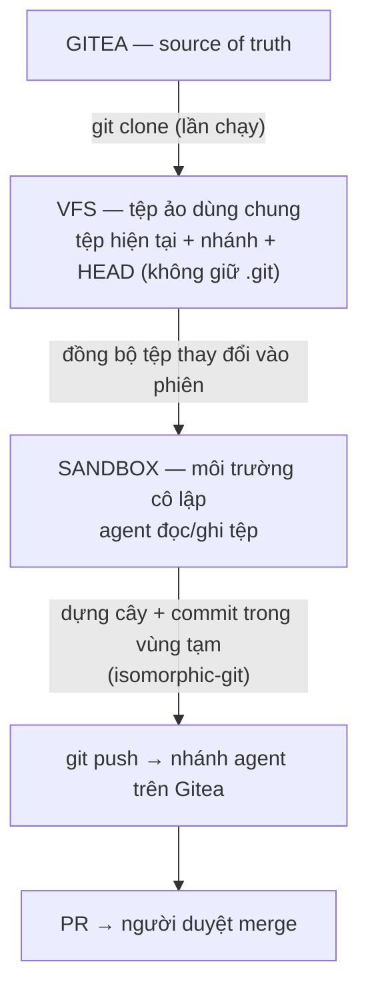

# Data Flow — mã nguồn đi qua đâu (2.6a)

## Dòng chính: Git → VFS → Sandbox

Nguyên tắc (theo [Contract Git](/docs/architecture/giao-tiep#contract-git)): **1 agent — 1
nhánh**, không đẩy thẳng `main`, tệp dự án sống độc lập với phiên sandbox.

## Dòng phụ: spec & agents qua factory repo

- Workflow spec (`workflows/*.spec.yaml`) và persona agent (`agents/*.md`) nằm trong **factory
  repo** — nguồn sự thật quản lý bằng Git.
- Backend **sync** định kỳ/theo lệnh `POST /api/v1/flows/sync`; mỗi lần sync trả **SHA** của commit
  factory — mọi run ghi rõ chạy theo SHA nào → truy vết được "workflow này sinh ra từ phiên bản nào".
- Secret **không bao giờ** nằm trong factory repo — chỉ tên ref. Xem
  [Secret & quyền](/docs/architecture/phan-quyen-bao-mat/secret-va-quyen).
