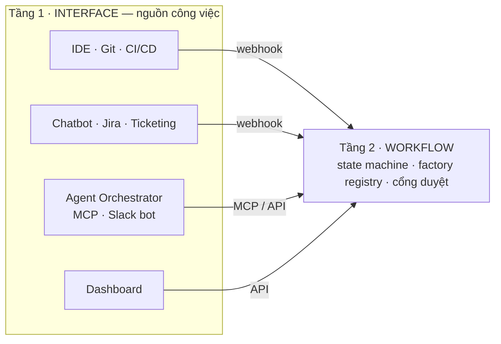

# Tầng 1 · Interface — nguồn công việc

## Nguyên tắc: không ép một giao diện duy nhất

Tầng 1 **không xử lý nghiệp vụ** — nó chỉ làm một việc: thu nhận tín hiệu công việc từ nơi việc
sinh ra, chuẩn hóa, rồi đẩy về control plane. Nhờ vậy:

- Mỗi vai trò khởi tạo công việc ngay tại **môi trường làm việc tự nhiên** của mình — dev không phải
  rời IDE, PM không phải học công cụ kỹ thuật.
- Không có bước "gom việc về một nơi rồi phân phát lại" — giảm ma sát tiếp nhận và mất mát ngữ cảnh.
- **Agent cũng chỉ là một người dùng** của tầng này: agent orchestrator giao việc qua cùng cơ chế
  như con người, đi qua cùng control plane, chịu cùng cổng duyệt.

## Kênh công việc theo vai trò

| Nhóm vai trò | Kênh giao việc | Công việc điển hình |
|---|---|---|
| Lập trình viên & QA | IDE · Git repo (issue/PR) · pipeline CI/CD | sửa lỗi, thêm tính năng, xử lý pipeline đỏ |
| PM / Marketing / Operations | Chatbot web · Jira · Ticketing | yêu cầu nội dung, ticket nghiệp vụ |
| Agent orchestrator | OpenCode qua MCP · Slack bot cho người không dùng IDE | giao việc bằng ngôn ngữ tự nhiên, chạy quy trình nhiều bước |
| Người vận hành | Dashboard | khởi tạo job, duyệt cổng, theo dõi tiến độ |

## Các thành phần

- **Webhook nhận việc:** nguồn ngoài (Git, ticketing) đẩy sự kiện vào backend qua
  `POST /webhooks/{source}` — backend xác thực nguồn, ánh xạ sự kiện sang task type rồi tạo task.
  Xem [API Reference](/docs/reference/api-rest).
- **Agent orchestrator (OpenCode):** giao việc bằng ngôn ngữ tự nhiên qua MCP; có Slack bot cho
  người không dùng IDE. Xem [HDSD Agent orchestrator](/docs/user-guides/opencode-orchestrator/gioi-thieu).
- **Dashboard:** giao diện quản trị tập trung cho người vận hành — tạo job, duyệt, xem tiến độ.
  Xem [HDSD Dashboard](/docs/user-guides/workloop-dieu-phoi/giao-dien-dashboard).

## Từ tín hiệu đến task

Mọi kênh trên hội tụ về một điểm kết thúc duy nhất — **một task trong state machine của Tầng 2**:

1. Sự kiện đến từ một kênh (webhook, MCP, Slack, dashboard API).
2. Backend xác thực và ánh xạ sự kiện sang task type đã đăng ký trong factory registry.
3. Task vào hàng chờ của control plane — từ đây vòng đời do Tầng 2 điều phối.

## Mối nối với tầng dưới

Không có công việc nào đi tắt khỏi control plane — kể cả agent orchestrator cũng phải tạo task,
không gọi thẳng harness hay sandbox. Quy ước hợp đồng cho các kết nối này:
[Giao tiếp & Contracts](/docs/architecture/giao-tiep). Khi nguồn ngoài gián đoạn:
[Kiểm chứng & phục hồi](/docs/architecture/kiem-chung-phuc-hoi/ba-vong-cai-tien).
