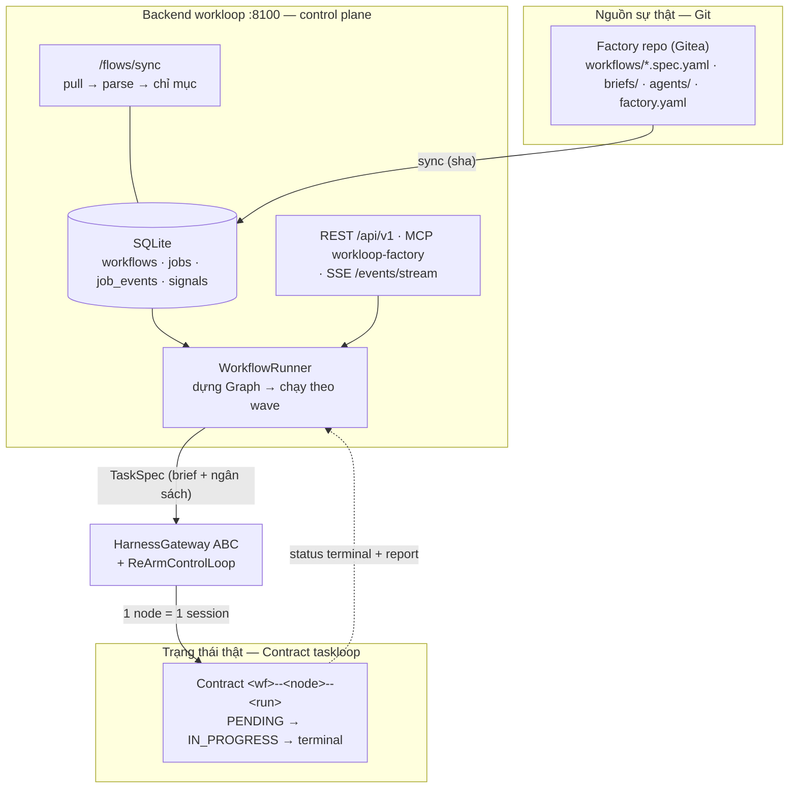

# Tầng 2 · Workflow — control plane

> Grounded vào mã nguồn `workloop` (backend FastAPI `:8100`, engine DAG lfx vendored, gateway taskloop).

Control plane trả lời ba câu hỏi: **chạy cái gì** (factory registry), **đang chạy tới đâu**
(state machine vòng đời) và **được phép đi tiếp không** (cổng duyệt). Nó **không thực thi công
việc** — việc thật do agent ở Tầng 3 làm; tầng này chỉ ra quyết định và giữ trạng thái.

## Ba nhiệm vụ của control plane

1. **Factory registry** — workflow được *định nghĩa trong factory repo* (Git = nguồn sự thật);
   backend sync về và chỉ giữ bản **chỉ mục** phục vụ tra cứu. Mỗi run gắn với đúng SHA của lần
   sync. Chi tiết: [Factory registry](/docs/architecture/tang-2-workflow/factory-registry).
2. **State machine vòng đời** — mỗi node có **contract taskloop** là nguồn sự thật của trạng thái
   (6 trạng thái chuẩn, mọi harness phải map về đây); DB chỉ là chỉ mục + event trail phục vụ
   tra cứu/timeline. Chi tiết: [State machine vòng đời](/docs/architecture/tang-2-workflow/state-machine).
3. **Cổng duyệt (gates)** — ba chốt đỏ **đặc tả → mã nguồn → sản phẩm**; mỗi chốt là một cơ chế
   riêng (PR spec có duyệt · node review agent/human · lifecycle duyệt sản phẩm). Chi tiết:
   [Cổng duyệt & HITL](/docs/architecture/tang-2-workflow/cong-duyet-hitl).

Ngoài ra tầng này chịu trách nhiệm **cách chạy**: DAG theo wave, rẽ nhánh deterministic, và
**chịu lỗi giữa run** (re-arm, pause/resume checkpoint) —
[Thực thi DAG](/docs/architecture/tang-2-workflow/thuc-thi-dag) ·
[Chịu lỗi & phục hồi](/docs/architecture/tang-2-workflow/chiu-loi-phuc-hoi).

## Bốn nguyên tắc thiết kế

| Nguyên tắc | Ý nghĩa trong mã nguồn |
|---|---|
| **Git là nguồn sự thật của spec** | Sửa spec = commit + push; run lưu `sha` để trace ngược đúng phiên bản; sync tự prune workflow không còn trong tree |
| **Contract là nguồn sự thật của trạng thái** | Engine chỉ đọc/ghi trạng thái qua DTO `Contract`; DB không phải nơi quyết định |
| **Kiểm soát ở ranh giới là code, không nhờ LLM** | Điều kiện rẽ nhánh, bộ đếm vòng review, gate `DONE`-only đều là code deterministic — LLM không được tự chế trạng thái |
| **Fail-closed** | Thiếu ngữ cảnh → `NEEDS_CONTEXT`; reviewer không kết luận rõ → chặn; node không set terminal → `DONE_WITH_CONCERNS` có cảnh báo — không có trạng thái "âm thầm coi là xong" |

## Các trang trong mục này

| Trang | Nội dung |
|---|---|
| [State machine vòng đời](/docs/architecture/tang-2-workflow/state-machine) | 6 trạng thái contract, trạng thái job, ai ghi trạng thái, fail-closed |
| [Factory registry](/docs/architecture/tang-2-workflow/factory-registry) | Spec trong Git, sync, phiên bản hoá, run context |
| [Thực thi DAG](/docs/architecture/tang-2-workflow/thuc-thi-dag) | Spec → DAG, wave song song, join policy, rẽ nhánh, node types |
| [Cổng duyệt & HITL](/docs/architecture/tang-2-workflow/cong-duyet-hitl) | 3 chốt đỏ, vòng review lặp, hàng đợi duyệt người |
| [Chịu lỗi & phục hồi](/docs/architecture/tang-2-workflow/chiu-loi-phuc-hoi) | Re-arm, taxonomy lỗi, PAUSE/RESUME checkpoint, resume node-level |

:::info[Hướng dẫn sử dụng]

Kiến trúc ở trên trả lời câu hỏi **"hệ thống vận hành thế nào"**; để **tự tay vận hành**, đi theo
trình tự: [cài đặt](/docs/user-guides/workloop-dieu-phoi/cai-dat) một lần →
[vòng 4 bước](/docs/user-guides/workloop-dieu-phoi/vong-4-buoc)
(configure → run → quan sát → review) → [xử cố](/docs/user-guides/workloop-dieu-phoi/xu-co) khi
run treo hoặc lỗi. Tra nhanh trong lúc làm: [MCP Tools](/docs/reference/mcp-tools) ·
[API REST](/docs/reference/api-rest) · [Trạng thái](/docs/reference/trang-thai).

:::
