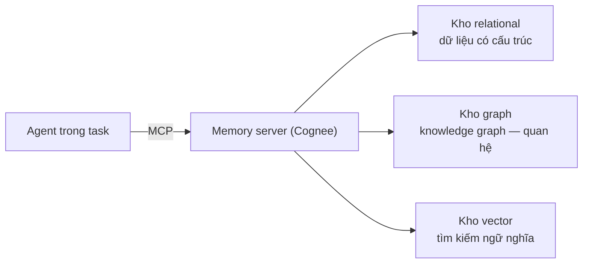

# Agent Memory (Cognee) — ngữ cảnh dự án

## Vai trò trong hệ thống

Memory là plugin của harness cung cấp **ngữ cảnh dự án** (Project Memory): mỗi agent khi vào task
không bắt đầu từ con số 0 mà truy vấn được tri thức đã nạp — quy ước dự án, cấu trúc repo, quyết
định thiết kế, kinh nghiệm từ các run trước.

## Kiến trúc: một MCP server, ba kho

- Agent **nạp tài liệu** (docs, quyết định, quy ước) và **truy vấn** qua giao diện MCP.
- Kho **graph** giữ knowledge graph — phù hợp truy vấn quan hệ ("tính năng X phụ thuộc module Y").
- Kho **vector** phục vụ tìm kiếm ngữ nghĩa theo nghĩa, không phụ thuộc từ khóa chính xác.

## Liên kết

- **Dùng trong task:** brief của node có thể dẫn chiếu tài liệu memory; orchestrator nạp ngữ cảnh
  trước khi giao việc.
- **Truy cập qua harness:** memory bridge của core runtime kết nối tới memory server qua MCP.

:::info[Hướng dẫn sử dụng]

Trang này mô tả kiến trúc ba kho; thao tác thực tế — nạp tài liệu vào memory, truy vấn theo từng
kho, kiểm tra dữ liệu đã nạp — xem [HDSD Agent Memory](/docs/user-guides/agent-memory-cognee/gioi-thieu).

:::

:::note[Nội dung đang bổ sung]
Mô tả chi tiết API, schema dữ liệu và quy trình nạp tài liệu sẽ được bổ sung bởi người phụ trách
mảng Agent Memory.
:::
