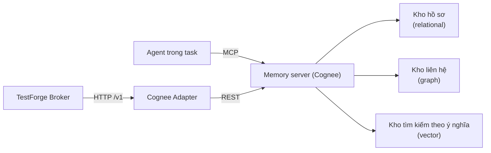
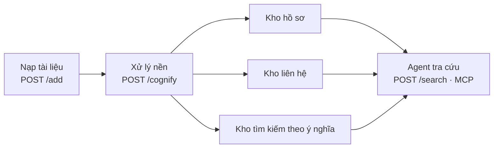

# Agent Memory (Cognee) — ngữ cảnh dự án

## Vai trò trong hệ thống

Memory là plugin của harness cung cấp **ngữ cảnh dự án** (Project Memory): mỗi agent khi vào task
không bắt đầu từ con số 0 mà truy vấn được tri thức đã nạp — quy ước dự án, cấu trúc repo, quyết
định thiết kế, kinh nghiệm từ các run trước. Kết quả đo trên dự án thực: cùng một chức năng, có
Memory tiết kiệm khoảng 75% token khi không dùng.

Khi cần lấy ngữ cảnh testcase, TestForge hỏi bộ nhớ qua **Cognee Adapter** — dùng chung dữ liệu
nhưng dùng bộ credential riêng, không lẫn với credential của agent phát triển
(xem [Memory → TestForge](/docs/user-guides/agent-memory-cognee/tich-hop-testforge)).

## Kiến trúc triển khai

Bộ nhớ tri thức chạy dạng container trên server AI nội bộ, gồm ba thành phần:

| Thành phần | Vai trò | Kết nối |
|---|---|---|
| **Memory Server** | Đọc tài liệu, nối thông tin, ghi nhớ vào 3 kho | REST API nội bộ |
| **MCP Server** | Cổng hỏi – đáp mà agent dùng | MCP transport HTTP, dùng chung vùng lưu trữ với Memory Server |
| **Giao diện web** | Người quản trị xem dataset, trực quan hoá knowledge graph | Trình duyệt |

Ba thành phần dùng chung một vùng lưu trữ, nên dữ liệu mà agent tra cứu qua MCP luôn là dữ liệu
mới nhất đã nạp. 

## Ba kho — mỗi kho một việc, kết nối linh hoạt

| Kho | Việc của kho | Ví dụ câu hỏi agent hỏi được |
|---|---|---|
| **Kho hồ sơ** (relational) | Lưu dữ liệu có cấu trúc: tài liệu, nguồn gốc | "Tài liệu này thuộc dự án nào, phiên bản nào?" |
| **Kho liên hệ** (graph) | Nối quan hệ giữa các thông tin | "Chức năng X dựa trên yêu cầu nào, sửa ảnh hưởng phần nào?" |
| **Kho tìm kiếm theo ý nghĩa** (vector) | Tìm theo nội dung, không cần đúng từ khóa | "Quy định về phân quyền ở tài liệu nào?" |

Cả ba kho đều **không khóa vào một sản phẩm cơ sở dữ liệu cụ thể** — cấu hình một dòng là đổi
được nơi lưu trữ, không phải sửa ứng dụng:

| Loại kho | Các lựa chọn được hỗ trợ |
|---|---|
| Kho hồ sơ | SQLite, PostgreSQL, Turso |
| Kho liên hệ | Kuzu, Neo4j, Neptune, Ladybug |
| Kho tìm kiếm theo ý nghĩa | LanceDB, pgvector (chạy cùng PostgreSQL), Turso |

Nhờ vậy, mỗi dự án chọn cấu hình phù hợp quy mô của mình: dùng bản nhúng (SQLite, Kuzu, LanceDB)
để chạy nhanh, gọn khi thí điểm; chuyển sang PostgreSQL, Neo4j khi cần chia sẻ nhiều người dùng
và mở rộng — **quy trình nạp và tra cứu giữ nguyên không đổi**.

## Mô hình AI linh hoạt

Việc đọc tài liệu, nối thông tin và trả lời liền mạch do **mô hình ngôn ngữ lớn (LLM)** đảm nhiệm
— và LLM cũng thay đổi được: hệ thống kết nối được với OpenAI, Azure, Ollama (chạy nội bộ) hoặc
bất kỳ gateway nào chuẩn OpenAI. Hiện dự án dùng mô hình GLM qua gateway NetMind của Viettel; đổi
sang mô hình khác chỉ cần sửa cấu hình, dữ liệu tri thức đã nạp **không phải nạp lại**. Người dùng
không cần cấu hình gì ở bước này.

## Luồng dữ liệu trong bộ nhớ

Việc đưa tri thức vào bộ nhớ đi qua ba bước:

1. **Đọc tài liệu** — mỗi tài liệu (Word, Excel, PDF, Markdown) được nạp vào một **bộ sưu tập**
   (dataset) theo phạm vi: một dự án, một vai trò hoặc một chủ đề.
2. **Nối thông tin** — hệ thống xử lý nền: phân đoạn nội dung, tìm các mối liên hệ giữa chức
   năng – yêu cầu – dữ liệu – mã nguồn, rồi ghi vào cả ba kho. Việc này chạy sau khi nạp, mất vài
   phút, agent không phải chờ.
3. **Ghi nhớ sẵn sàng** — khi xử lý xong, bộ sưu tập chuyển trạng thái "hoàn thành" và agent có
   thể tra cứu ngay.

Quy trình nạp và truy vấn chi tiết ở [HDSD Agent Memory](/docs/user-guides/agent-memory-cognee/gioi-thieu).

## Bộ sưu tập là đơn vị phân quyền

Mỗi bộ sưu tập là một "bộ não" độc lập. Agent chỉ tra cứu được những bộ sưu tập thuộc phạm vi của
mình — dự án nào được cấp thì thấy dự án đó, không thấy phần còn lại.

Quy ước đặt tên đang dùng: tên dự án + loại nội dung (ví dụ `tnqd_requirements` là hồ sơ yêu cầu
dự án TNQĐ), và bộ sưu tập riêng của agent đặt hậu tố `_agentmemory_memory` để dễ nhận biết.

## Liên kết

- **Dùng trong task:** brief của node có thể dẫn chiếu tài liệu memory; orchestrator nạp ngữ cảnh
  trước khi giao việc.
- **Truy cập qua harness:** memory bridge của core runtime kết nối tới memory server qua MCP.
- **HDSD:** [Agent Memory — hướng dẫn sử dụng](/docs/user-guides/agent-memory-cognee/gioi-thieu).
- **Chế độ truy xuất:** danh sách đầy đủ tại
  [Memory → Tra cứu](/docs/user-guides/agent-memory-cognee/truy-van-bo-nho).
