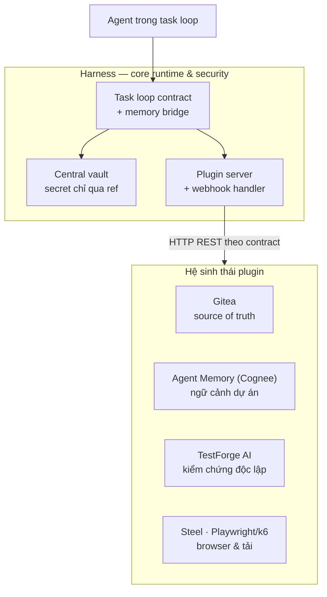

# Tầng 3 · Harness — bộ não & cánh tay hệ thống

## Core Runtime & Security

Harness là nơi một agent **có đủ năng lực hoàn thành nhiệm vụ**. Lõi gồm:

- **Task Loop Contract & Memory Bridge** — hợp đồng vòng làm việc của task và cầu nối sang memory.
- **Central Vault (secrets & security ingress)** — secret tập trung, agent chỉ nhận qua ref.
- **Harness Plugin Server & Webhook Handler** — điểm mở rộng cho plugin và nhận sự kiện.

## Hệ sinh thái plugin con

| Plugin | Vai trò |
|---|---|
| **Gitea** | Source of truth — Git repo, webhooks. Xem [công cụ hỗ trợ](/docs/user-guides/cong-cu-ho-tro/gitea) |
| **Agent Memory (Cognee)** | Knowledge graph — ngữ cảnh dự án. Xem [Cognee](/docs/architecture/tang-3-harness/cognee-agent-memory) |
| **TestForge AI** | Kiểm chứng độc lập + bằng chứng. Xem [TestForge](/docs/architecture/tang-3-harness/testforge-test-agent) |
| **Steel Browser** | Computer use, UI testing — click/screenshot cho agent |
| **Playwright + k6** | Test chức năng (Playwright API) + load test (k6) |

Giao tiếp giữa harness và các plugin con: **giao thức HTTP REST**.

## Nguyên tắc plugin

Mọi năng lực (model/runtime, tools/connectors, memory, sandbox, testing, artifact delivery) nối
vào harness qua **điểm mở rộng rõ ràng**, theo contract định sẵn — xem
[Viết plugin](/docs/developer-docs/viet-plugin).

:::info[Hướng dẫn sử dụng]

Để làm với harness (không chỉ đọc kiến trúc): cài đặt, tạo phiên agent và gọi plugin qua taskloop —
xem [HDSD Harness/DSH](/docs/user-guides/harness-dsh/gioi-thieu). Vai trò từng plugin con trong
bảng trên có trang riêng ở mục Hướng dẫn sử dụng.

:::
