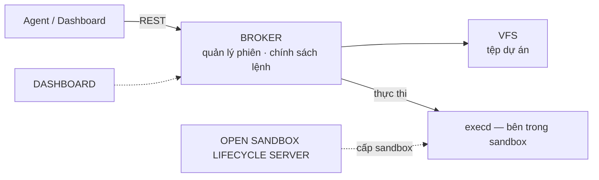

# Tầng 4 · Sandbox — thực thi cô lập

> Grounded vào mã nguồn `sandbox-kit` (branch `feat/sandbox`).

## Ba khác biệt cốt lõi

1. **Mã nguồn nằm riêng** — tệp sống trong VFS; phiên chỉ là môi trường thực thi.
2. **Kiểm soát tập trung** — mọi thao tác qua broker, lệnh bị lọc bởi command policy.
3. **Thay đổi qua dòng Git có phân vai** — agent chỉ push nhánh `agent-*`; merge do người
   duyệt.

## Luồng E2E của một lệnh

Nhận yêu cầu → kiểm tra command policy → thực thi cách ly trong sandbox → trả kết quả
(stdout · stderr · exit code · thời lượng) và ghi event log.

## Các trang trong mục này

| Trang | Nội dung |
|---|---|
| [Tổng quan](/docs/architecture/tang-4-sandbox/gioi-thieu) | Sandbox Kit là gì, giải quyết vấn đề gì, khái niệm chính |
| [Broker](/docs/architecture/tang-4-sandbox/broker) | Cổng REST, chính sách lệnh, vòng đời phiên tự động |
| [VFS](/docs/architecture/tang-4-sandbox/vfs) | Tệp dự án độc lập phiên, dòng Git phân vai |
| [OpenSandbox server](/docs/architecture/tang-4-sandbox/opensandbox-server) | Cấp sandbox cách ly, cấu hình tài nguyên |
| [Dashboard & CLI](/docs/architecture/tang-4-sandbox/dashboard-cli) | Quản trị phiên, tích hợp agent |

:::info[Hướng dẫn sử dụng]

Vận hành Sandbox Kit theo trình tự của một task: [cài đặt](/docs/user-guides/sandbox-kit/cai-dat)
một lần → [tạo & quản lý phiên](/docs/user-guides/sandbox-kit/quan-ly-phien) →
[đồng bộ tệp VFS](/docs/user-guides/sandbox-kit/dong-bo-vfs) khi nạp/cập nhật mã nguồn →
[review diff & merge](/docs/user-guides/sandbox-kit/review-diff) trước khi gộp. Dọn dẹp đúng lúc bằng
[tài nguyên & vòng đời phiên](/docs/user-guides/sandbox-kit/tai-nguyen-vong-doi). Mô hình các lớp
rào chắn bên dưới: [Bảo mật nhiều lớp](/docs/architecture/phan-quyen-bao-mat/bao-mat-nhieu-lop).

:::
